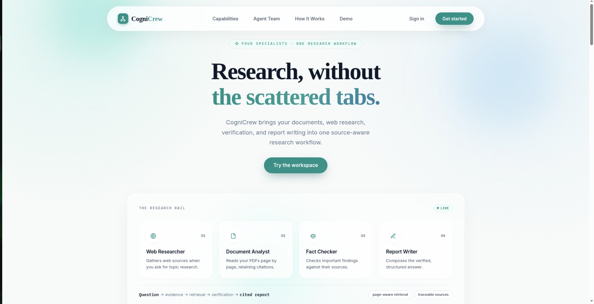
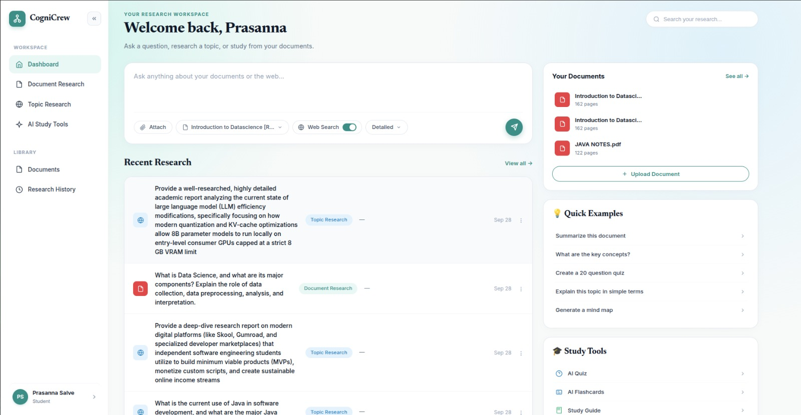
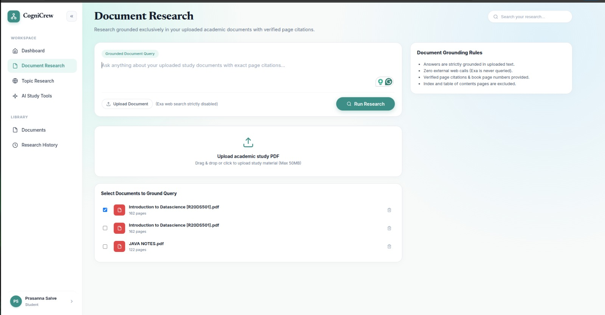

# CogniCrew

## Project Overview

CogniCrew is an academic research assistant designed to ground answers strictly in verified source materials. It enables students and researchers to upload academic and technical PDF documents, automatically parses each page, classifies content (distinguishing narrative explanations from front matter, tables of contents, and indexes), extracts printed page numbers, and retrieves verbatim evidence passages to answer queries with page-specific citations.

The platform provides a responsive, single-origin web application where users can manage their document library, conduct document-grounded research, conduct interactive follow-up Q&A conversations grounded in previously retrieved document contexts, and review historical research reports.

---

## Quick Start

```bash
git clone https://github.com/Prasannas19/cognicrew.git
cd cognicrew
cp backend/.env.example backend/.env   # fill in your own keys
pip install -r backend/requirements.txt
npm start                              # serves https://localhost:4000
```

Requires Python 3.11+ and a PostgreSQL database (see `backend/.env.example` for all settings).

---

## Screenshots

| Landing Page | Dashboard |
| :---: | :---: |
|  |  |

| Document Research |
| :---: |
|  |

---

## Technology Stack

The following table lists only the technologies proven by the actual source code:

| Technology | Purpose | Location |
| :--- | :--- | :--- |
| **Python 3.11+** | Backend programming language | `backend/` |
| **FastAPI 0.115.12** | Asynchronous Web & REST API framework; serves both API and static frontend | `backend/app/main.py`, `backend/app/routers/` |
| **Uvicorn 0.34.2** | ASGI HTTP server for FastAPI | `package.json`, command line |
| **SQLAlchemy 2.0.40** | Database ORM, connection pooling, and SQL expression construction | `backend/app/database.py`, `backend/app/models.py` |
| **PostgreSQL** | Relational database engine for users, sessions, documents, and research history | `database/migrations/001_initial.sql` |
| **psycopg (v3) / psycopg2-binary** | PostgreSQL database adapters | `backend/app/database.py`, `backend/requirements.txt` |
| **PyMuPDF (fitz) 1.25.5** | High-performance PDF page extraction and text processing | `backend/app/document_pipeline.py` |
| **Argon2-cffi 23.1.0** | Cryptographic password hashing | `backend/app/security.py` |
| **Pydantic / Email-validator** | Request payload validation and serialization | `backend/app/routers/` |
| **Vanilla HTML5** | Semantic structure for all web pages | `frontend/*.html` |
| **Vanilla CSS3** | Custom responsive design system with CSS variables and glassmorphism | `frontend/css/styles.css` |
| **Vanilla JavaScript (ES6+)** | Frontend client-side logic, asynchronous API communication, navigation, and DOM updates | `frontend/js/app.js`, inline scripts |
| **Pytest 9.1.1** | Test execution framework with Starlette `TestClient` (via `httpx`) | `tests/`, `pytest.ini` |

---

## Project Structure

```
project/
├── backend/                  # FastAPI backend application
│   ├── app/
│   │   ├── routers/          # API route handlers
│   │   │   ├── __init__.py
│   │   │   ├── auth.py       # User registration, login, logout, session verification
│   │   │   ├── contact.py    # Inquiries submission with client-IP rate limiting
│   │   │   ├── documents.py  # PDF upload, listing, and cascading deletion
│   │   │   ├── history.py    # Past research reports and conversation threads
│   │   │   └── research.py   # Document research execution and follow-up Q&A
│   │   ├── __init__.py
│   │   ├── database.py       # SQLAlchemy engine, session maker, get_db dependency
│   │   ├── dependencies.py   # Cookie-based current_user dependency injection
│   │   ├── document_pipeline.py # PyMuPDF extraction, page classification, evidence ranking
│   │   ├── main.py           # Application entrypoint, CORS, router mounting, static files
│   │   ├── models.py         # SQLAlchemy ORM models (10 tables)
│   │   ├── security.py       # Argon2 password hashing and SHA-256 session token utilities
│   │   └── settings.py       # Configuration loader for environment variables
│   ├── .env                  # Local runtime environment file (git-ignored)
│   ├── .env.example          # Sample environment configuration template
│   └── requirements.txt      # Python package dependencies
├── frontend/                 # Static web assets served directly by FastAPI
│   ├── css/
│   │   └── styles.css        # Core design system, color tokens, and responsive styles
│   ├── js/
│   │   └── app.js            # Global navbar behavior, session status checker, mobile menu
│   ├── auth.html             # User authentication interface (Sign In & Sign Up)
│   ├── contact.html          # Academic project contact form
│   ├── dashboard.html        # Workspace: upload dropzone, document list, research query UI, results, follow-up chat
│   ├── faq.html              # Interactive accordion FAQ page
│   ├── history.html          # Research history viewer and detailed report inspector
│   └── index.html            # Public landing page with features and previews
├── database/                 # Database schemas and migrations
│   └── migrations/
│       └── 001_initial.sql   # PostgreSQL DDL creating extensions, enums, tables, and indexes
├── storage/                  # Persistent filesystem storage for uploaded files
│   └── uploads/              # Uploaded PDF files organized by user UUID: {user_id}/{document_id}.pdf
├── tests/                    # Pytest automated test suite
│   ├── conftest.py           # Pytest fixtures: TestClient, registered_user, deterministic_pdf_bytes
│   ├── test_auth.py          # Registration, duplicate email prevention, login session tests
│   ├── test_contact.py       # Contact form persistence and rate-limiting tests
│   ├── test_document_pipeline.py # Page classification and printed label extraction unit tests
│   ├── test_documents.py     # PDF upload, listing, isolation, and cascade deletion tests
│   ├── test_history.py       # Past report listing and full detail retrieval tests
│   └── test_research.py      # Double-buffering grounded retrieval and Exa 503 check tests
├── scripts/                  # Standalone utilities and verification scripts
│   └── test_e2e_full.py      # Comprehensive 11-step end-to-end integration test script
├── .gitignore                # Git ignore patterns for virtualenv, storage, caches, and secrets
├── .gitattributes            # Line ending configuration
├── .prettierignore           # Prettier ignore definitions
├── .prettierrc               # Prettier configuration
├── package.json              # Retained only as a convenience launcher for the Uvicorn/FastAPI backend; not used to build or serve the frontend
├── pytest.ini                # Pytest configuration pointing to tests/ with backend in pythonpath
└── README.md                 # Project documentation (this file)
```

---

## Frontend Architecture

- **Technology**: Built entirely with Vanilla HTML5, CSS3, and modern JavaScript (ES6+). The frontend runs natively in the browser without any bundlers, transpilations, or client-side UI libraries.
- **Pages**:
  - `/` (`index.html`): Public marketing and landing page highlighting academic document research features, sample queries, and workflows.
  - `/auth` (`auth.html`): Interactive authentication form providing toggleable tabs for Sign In and Account Registration.
  - `/dashboard` (`dashboard.html`): Central research workspace featuring:
    - Drag-and-drop PDF upload zone with client-side file validation.
    - User document library table displaying filename, page count, file size, upload date, and single-click deletion.
    - Research query box with mode selectors (`Document Research`, `Topic Research`, `Combined Research`), clickable suggested topic chips, and status loaders.
    - Verified report view rendering direct answers, document citation cards with PDF and printed book page numbers, verbatim excerpts, and match scores.
    - Grounded follow-up chat thread allowing continuous conversation against the retrieved document context.
  - `/history` (`history.html`): Dedicated research history page showing cards for past reports with clickable drill-down inspection of full excerpts and chat history.
  - `/faq` (`faq.html`): Frequently asked questions with animated accordion disclosure widgets.
  - `/contact` (`contact.html`): Contact form with client-side input validation and asynchronous submission feedback.
- **Styling**: `frontend/css/styles.css` provides a design system inspired by academic publishing: clean typography (Inter, Georgia display serif, IBM Plex Mono), HSL teal accent colors, glassmorphic cards with frosted-glass backdrop filters, and responsive flexbox/grid layouts.
- **API Communication**: All frontend actions use native browser `window.fetch` to communicate with FastAPI REST endpoints, exchanging JSON payloads or multipart `FormData` for uploads.
- **Authentication Handling**: Session state is determined by querying `GET /auth/me`. If authenticated, navigation buttons dynamically switch to "Workspace" / "Dashboard". Protected views redirect unauthenticated users to `/auth`.

---

## Backend Architecture

- **Entry Point**: `backend/app/main.py` instantiates the `FastAPI` application, configures CORS middleware, registers routers, implements the `/health` check endpoint, and mounts `frontend/` as static file middleware.
- **Routers**:
  - `auth`: Manages registration (`POST /auth/register`), authentication (`POST /auth/login`), session termination (`POST /auth/logout`), and active user profile (`GET /auth/me`).
  - `documents`: Handles user document listing (`GET /documents`), PDF upload and parsing (`POST /documents/upload`), and document deletion (`DELETE /documents/{document_id}`).
  - `research`: Executes research queries (`POST /research/run`) and manages follow-up conversational messages (`POST /research/{report_id}/follow-ups`).
  - `history`: Lists historical reports (`GET /history/reports`) and fetches full report details (`GET /history/reports/{report_id}`).
  - `contact`: Captures feedback (`POST /contact`) with client IP rate limiting.
- **Authentication & Security** (`backend/app/security.py`, `backend/app/dependencies.py`):
  - Passwords are validated for a minimum length of 12 characters and hashed using Argon2 (`argon2-cffi`).
  - Sessions use high-entropy cryptographically secure random tokens (`secrets.token_urlsafe(48)`) issued via `HttpOnly`, `SameSite=Lax` cookies with a 7-day expiration.
  - The database stores only the SHA-256 hash of the session token (`token_hash`), ensuring tokens cannot be leaked from database dumps.
  - The `current_user` FastAPI dependency validates cookies, confirms session validity and expiration, and injects the authenticated `User` into protected endpoints.
- **Document Pipeline** (`backend/app/document_pipeline.py`):
  - Pure-Python module with zero database or external web dependencies, making document extraction and evidence rules completely deterministic and unit-testable.
  - Uses PyMuPDF (`fitz`) to read PDFs page by page, normalizing unicode ligatures and sanitizing null bytes.
  - Classifies page kinds (`content`, `toc`, `index`, `bibliography`, `navigation`, `unknown`) to exclude non-content pages (such as tables of contents and indexes) from being treated as explanatory evidence.
  - Detects printed book page numbers directly from page edge headers/footers, requiring corroboration from adjacent sequential page labels to prevent false positives from TOC references.
  - Uses question-scaffolding filters, phrase extraction, and answer-marker detection to score and rank verbatim evidence passages.
- **Database Layer** (`backend/app/database.py`, `backend/app/models.py`):
  - SQLAlchemy 2.0 with connection pooling (`pool_pre_ping=True`).
  - Exposes `Base` declarative base, `SessionLocal` session factory, and a FastAPI generator dependency `get_db`.
- **Storage Layer**:
  - Uploaded PDF binaries are persisted to the filesystem under `storage/uploads/{user_id}/{document_id}.pdf`.

---

## Database Architecture

- **Database Engine**: PostgreSQL (tested with Neon Serverless PostgreSQL over SSL).
- **ORM**: SQLAlchemy 2.0 mapped models using strict typing (`Mapped[...]`).
- **Schema & Migrations**: `database/migrations/001_initial.sql` defines PostgreSQL extensions, custom ENUM types, tables, constraints, and indexes.

### Tables & Relationships

```
 users (id UUID PK)
   ├── sessions (user_id FK -> users.id CASCADE)
   ├── documents (owner_id FK -> users.id CASCADE)
   │     └── document_pages (document_id FK -> documents.id CASCADE)
   │           └── research_sources (document_page_id FK -> document_pages.id SET NULL)
   ├── research_queries (owner_id FK -> users.id CASCADE)
   │     ├── research_query_documents (query_id FK, document_id FK)
   │     └── reports (query_id FK -> research_queries.id CASCADE, owner_id FK -> users.id CASCADE)
   │           ├── research_sources (report_id FK -> reports.id CASCADE)
   │           └── chat_messages (report_id FK -> reports.id CASCADE, owner_id FK -> users.id CASCADE)
   └── contact_messages (id UUID PK - independent)
```

1. **`users`**: User identity (`id`, `name`, `email` [UNIQUE], `password_hash`, `created_at`).
2. **`sessions`**: Active authentication sessions (`id`, `user_id`, `token_hash` [UNIQUE], `expires_at`, `created_at`, `revoked_at`).
3. **`documents`**: Metadata for uploaded PDFs (`id`, `owner_id`, `original_name`, `storage_key` [UNIQUE], `mime_type`, `byte_size`, `page_count`, `created_at`).
4. **`document_pages`**: Extracted page text and metadata (`id`, `document_id`, `pdf_page_number`, `printed_page_label`, `page_kind`, `extracted_text`, `created_at`). Unique on `(document_id, pdf_page_number)`.
5. **`research_queries`**: User research questions (`id`, `owner_id`, `question`, `mode` [documents, topic, combined], `status`, `created_at`).
6. **`research_query_documents`**: Junction table linking queries to attached documents.
7. **`reports`**: Generated research reports (`id`, `query_id` [UNIQUE], `owner_id`, `summary`, `body` [JSONB], `not_found`, `created_at`).
8. **`research_sources`**: Evidentiary passages supporting a report (`id`, `report_id`, `source_type` [document, web], `document_page_id`, `title`, `url`, `excerpt`, `retrieved_at`).
9. **`chat_messages`**: Conversational follow-ups attached to a report (`id`, `report_id`, `owner_id`, `role` [user, assistant], `text`, `citations` [JSONB], `created_at`).
10. **`contact_messages`**: User contact submissions (`id`, `name`, `email`, `message`, `created_at`).

---

## Document Processing Workflow

The actual document processing pipeline follows this deterministic sequence:

```
PDF File Upload
  │
  ▼
[Validation]
  ├── Verify MIME type is 'application/pdf' (HTTP 415 if invalid)
  └── Check file size is > 0 and <= MAX_UPLOAD_BYTES (50MB default, HTTP 413 if exceeded)
  │
  ▼
[Storage]
  └── Persist binary to filesystem at storage/uploads/{user_id}/{doc_id}.pdf
  │
  ▼
[Page-by-Page Extraction] (PyMuPDF)
  ├── Extract individual pages as discrete units (preserving 1-based PDF page numbers)
  ├── Clean and normalize unicode ligatures (NFKD) and strip null bytes
  │
  ▼
[Page Classification & Edge Label Mapping]
  ├── Classify page kind (content, toc, index, bibliography, navigation, unknown)
  └── Detect printed page numbers at top/bottom edges; corroborate with sequential adjacent pages
  │
  ▼
[Database Persistence]
  ├── Create Document record in PostgreSQL
  └── Bulk insert DocumentPage records containing extracted text, page kinds, and printed labels
  │
  ▼
[Evidence Retrieval] (On Research Query)
  ├── Analyze question for concept anchors, key phrases, and answer markers (e.g. "is called", "means")
  ├── Filter out non-content pages (TOC, Index, Navigation)
  ├── Score content pages by term match, phrase match, and explanatory definitions
  ├── Extract high-relevance excerpt windows around matching concepts
  │
  ▼
[Response & Storage]
  └── Save Report and ResearchSource records with PDF and book page references
```

---

## Research Workflow

CogniCrew supports three research modes handled in `backend/app/routers/research.py`:

1. **Document Research (`mode="documents"`)**:
   - **Prerequisites**: Requires at least one uploaded document selected (`document_ids`).
   - **Mechanism**: Completely local and deterministic. Retrieves text pages from PostgreSQL, passes them to `retrieve_document_evidence()` in `document_pipeline.py`, extracts matching passages, formats direct answers, and links sources.
   - **External dependencies**: None. Runs 100% offline.
2. **Topic Research (`mode="topic"`)**:
   - **Prerequisites**: Documents cannot be attached. Requires `EXA_API_KEY` configured in `.env`.
   - **Mechanism**: When `EXA_API_KEY` is missing, the endpoint honestly and explicitly returns `HTTP 503 Service Unavailable` with message `"EXA_API_KEY is not configured."` without fabricating results.
3. **Combined Research (`mode="combined"`)**:
   - **Prerequisites**: Requires both uploaded documents and `EXA_API_KEY`.
   - **Mechanism**: Combines document-grounded evidence with external web search. If `EXA_API_KEY` is not set, explicitly returns `HTTP 503`.

---

## Authentication Workflow

- **Registration (`POST /auth/register`)**:
  - Validates user name (2-80 chars), email format, and password (minimum 12 chars).
  - Checks for existing accounts; returns `409 Conflict` on duplicate emails.
  - Hashes password using Argon2, generates user UUID, and inserts into `users`.
  - Generates a 48-byte URL-safe session token, computes its SHA-256 hash, and stores a `sessions` record with a 7-day expiration.
  - Sets `session_token` as an `HttpOnly`, `SameSite=Lax` cookie on the response.
- **Login (`POST /auth/login`)**:
  - Looks up user by lowercased email.
  - Verifies password against stored Argon2 hash (returns `401 Unauthorized` on mismatch).
  - Creates a new active session record and sets the `session_token` cookie.
- **Session Verification (`GET /auth/me`)**:
  - Reads `session_token` cookie, computes SHA-256 hash, and queries active (non-revoked, unexpired) sessions in PostgreSQL.
  - Returns `{ "id": user_id, "name": name, "email": email }`.
- **Logout (`POST /auth/logout`)**:
  - Sets `revoked_at` timestamp on the active session record in the database.
  - Deletes the `session_token` client cookie.
- **Route Protection**:
  - Protected API routes declare `user: User = Depends(current_user)`. Unauthenticated requests automatically receive `401 Unauthorized`.

---

## API Endpoints

| Method | Endpoint | Purpose | Auth Required | Request / Response Details |
| :--- | :--- | :--- | :---: | :--- |
| `GET` | `/health` | Service health probe | No | Returns `{"status": "ok", "service": "cognicrew-python-backend"}` |
| `POST` | `/auth/register` | Register new user account | No | Body: `{name, email, password}`; sets cookie; returns user profile |
| `POST` | `/auth/login` | Authenticate existing user | No | Body: `{email, password}`; sets cookie; returns user profile |
| `POST` | `/auth/logout` | Revoke session and logout | Optional | Clears cookie; returns `{"message": "Signed out."}` |
| `GET` | `/auth/me` | Get current user profile | Yes (Cookie) | Returns `{id, name, email}` |
| `GET` | `/documents` | List user's uploaded documents | Yes (Cookie) | Returns list of documents with page counts and sizes |
| `POST` | `/documents/upload` | Upload and parse PDF document | Yes (Cookie) | `multipart/form-data` with `file`; returns document metadata |
| `DELETE` | `/documents/{id}` | Delete document and file | Yes (Cookie) | Cascades document pages, links, and removes storage file; returns 204 |
| `POST` | `/research/run` | Execute research query | Yes (Cookie) | Body: `{question, mode, document_ids}`; returns report, direct answer, sources |
| `POST` | `/research/{id}/follow-ups` | Ask follow-up question | Yes (Cookie) | Body: `{question}`; returns grounded answer and citations |
| `GET` | `/history/reports` | List past research reports | Yes (Cookie) | Query params: `limit`, `offset`; returns past summaries and question list |
| `GET` | `/history/reports/{id}` | Fetch full report and chat | Yes (Cookie) | Returns report summary, body sections, source cards, and chat messages |
| `POST` | `/contact` | Submit contact inquiry | No | Body: `{name, email, message}`; rate-limited to 3/10min per IP; returns 201 |
| `GET` | `/` | Main landing page | No | HTML page |
| `GET` | `/auth` | Authentication page | No | HTML page |
| `GET` | `/dashboard` | Research workspace | No | HTML page (prompts login if unauthenticated) |
| `GET` | `/history` | Research history viewer | No | HTML page |
| `GET` | `/faq` | FAQ page | No | HTML page |
| `GET` | `/contact` | Contact page | No | HTML page |

---

## Environment Variables

The application reads configuration from `backend/.env` (or root `.env`).

| Variable Name | Description |
| :--- | :--- |
| `DATABASE_URL` | PostgreSQL connection URI (e.g. `postgresql+psycopg://...` or `postgresql+psycopg2://...`) |
| `SESSION_SECRET` | Secret key for signing session tokens (must be at least 32 characters) |
| `ENVIRONMENT` | Deployment environment name (`development` or `production`) |
| `UPLOAD_DIRECTORY` | Filesystem path for storing uploaded PDF files (defaults to `./storage/uploads`) |
| `MAX_UPLOAD_BYTES` | Maximum allowable upload file size in bytes (defaults to 52,428,800 bytes / 50MB) |
| `EXA_API_KEY` | Optional API key for Exa web search engine (required only for Topic and Combined Research) |
| `CORS_ORIGINS` | Comma-separated list of allowed origins for CORS headers |

*(Note: Secrets, passwords, and tokens are never committed to version control.)*

---

## Running CogniCrew on Ubuntu

### 1. Prerequisites
Ensure Python 3.11+ and PostgreSQL are installed:
```bash
sudo apt update
sudo apt install -y python3 python3-venv python3-pip libpq-dev
```

### 2. Set Up Virtual Environment
From the repository root:
```bash
python3 -m venv .venv
source .venv/bin/activate
```

### 3. Install Dependencies
```bash
pip install -r backend/requirements.txt
```

### 4. Database Setup & Migrations
Create your PostgreSQL database (if running locally):
```bash
createdb cognicrew
```
Configure your `backend/.env` file:
```bash
cp backend/.env.example backend/.env
# Edit backend/.env to specify your valid DATABASE_URL and SESSION_SECRET
```
Apply the schema migration to PostgreSQL:
```bash
psql "$DATABASE_URL" -f database/migrations/001_initial.sql
```

### 5. Start the Application
CogniCrew uses a unified architecture where FastAPI directly serves both the REST API and the static frontend on a single port. No separate frontend process is required:

```bash
# Using uvicorn directly:
./.venv/bin/uvicorn app.main:app --host 0.0.0.0 --port 4000 --app-dir backend

# Or using the package.json convenience script (`package.json` is retained only as a convenience launcher for the Uvicorn/FastAPI backend; it is not used to build or serve the frontend):
npm run dev
```

### 6. Access the Application
Open your browser and navigate to:
```
http://localhost:4000
```
- Workspace Dashboard: `http://localhost:4000/dashboard`
- API Health Check: `http://localhost:4000/health`
- Interactive API Docs: `http://localhost:4000/docs`

---

## Testing

Automated testing is implemented using `pytest` and Starlette's `TestClient`.

### Run Unit and Integration Tests
```bash
./.venv/bin/pytest tests
```
Runs 14 test cases covering authentication, document extraction, page classification, ownership isolation, contact rate limiting, and research queries.

### Run Comprehensive End-to-End Test Suite
```bash
./.venv/bin/python scripts/test_e2e_full.py
```
Executes an 11-step end-to-end integration test verifying health endpoints, all 6 HTML pages, account registration, password validation, contact persistence in PostgreSQL, PDF upload with PyMuPDF parsing, the critical Double Buffering retrieval test (verifying TOC and index exclusion), grounded follow-up chat, Exa 503 check, cross-user isolation, and cookie logout.

---

## Java Usage

**Java is NOT part of the CogniCrew technology stack.**

An exhaustive scan of the repository confirms:
- **No Java source files**: There are zero `.java` or `.class` files in the codebase.
- **No Java runtime or build tools**: CogniCrew does not use the JDK, JRE, Maven, Gradle, or JVM.
- **Context of Java references**: Java appears exclusively as:
  1. **Research domain and test fixtures**: The application includes test cases (e.g. `JavaBook.pdf`, `Java_Deterministic_Fixture.pdf`) that test textbook retrieval for computer science topics such as *"Double Buffering in Java"*, *"Chapter 26: Images"*, and *"834 PART II The Java Library"*.
  2. **Sample UI prompts**: The dashboard includes suggested query chips such as *"Double Buffering in Java"* to demonstrate book-grounded retrieval.
  3. **Mock landing page assets**: Marketing mockups mention *"Java: A Beginner's Guide, 6th Edition.pdf"* as an example uploaded book.

CogniCrew is written 100% in Python, HTML5, CSS3, and JavaScript.

---

## Academic Relevance

CogniCrew demonstrates practical applications of foundational concepts and technologies from the undergraduate computer science and information technology curriculum:

### Strong & Direct Relevance
- **Web Technologies & Frontend Development**:
  - Semantic **HTML5** structure across landing, authentication, workspace, history, FAQ, and contact views.
  - Responsive **CSS3** layout using CSS custom properties (tokens), glassmorphism, flexbox, and responsive grid layouts without framework overhead.
  - **Vanilla JavaScript (ES6+)**: Direct DOM manipulation, asynchronous programming with Promises and the `fetch` API, event handling, dynamic modal/tab switching, and cookie-based state synchronization.
- **Backend Architecture**:
  - Asynchronous web service design using **Python** and **FastAPI**, RESTful routing, dependency injection (`current_user`, `get_db`), request/response validation with Pydantic, and secure password hashing using Argon2.
- **Database & Data Management**:
  - Relational database schema design in **PostgreSQL**, foreign-key relationships, constraints, indexing, CRUD operations, and ORM-based database access using **SQLAlchemy 2.0**.

### Domain Extensions
- **Document Processing**: Page-aware PDF parsing, text extraction, edge-label extraction, and page classification (TOC, index, content) via PyMuPDF (`fitz`).
- **Research & Evidence Retrieval**: Deterministic keyword/phrase n-gram matching, definitional markers, ubiquity filtering, and page-specific quotation attribution.
- **Data Handling**: Controlled file upload pipelines, filesystem storage organization, and structured JSON report formatting.

> **Curriculum Scope**: CogniCrew focuses specifically on modern web technology, database systems, Python backend services, and document research systems. It does not claim to implement the entire TY syllabus or unrepresented subjects (such as a Core Java runtime, Operating System kernel modules, Theory of Computer Science automata, Operations Research models, or general ML/AI algorithm suites like BFS, DFS, A*, Minimax, Alpha-Beta pruning, K-Means, SVM, ANN, or CNN).

---

## Current Limitations

1. **PDF Format Only**: The document pipeline currently accepts only PDF files (`application/pdf`). Other formats (DOCX, TXT, EPUB) are rejected by the upload validator.
2. **Text-Layer Requirement**: PyMuPDF extracts text directly from the PDF document stream; scanned image-only PDFs without an embedded OCR text layer will produce empty pages.
3. **Web Search Dependency**: Topic and Combined research modes require an active `EXA_API_KEY`. When unset, these modes return HTTP 503.
4. **Single-Node Rate Limiting**: The `/contact` endpoint uses an in-memory sliding window rate limiter per client IP address, which resets upon server restart and does not share state across distributed worker processes.

---

## Future Development

- Add OCR extraction support (e.g. Tesseract / PyTesseract) for scanned document PDFs.
- Add support for plain text and Markdown document uploads.
- Implement distributed Redis-based rate limiting for multi-worker production deployments.
- Support real-time streaming tokens for LLM-synthesized report summaries.

---

## Detailed Local Setup

The `npm start` script expects a Python virtual environment at `./.venv` and localhost TLS certificates in `certs/`. Both are git-ignored, so a fresh clone needs these extra steps:

```bash
python -m venv .venv
./.venv/bin/pip install -r backend/requirements.txt

mkdir -p certs
mkcert -install
mkcert -cert-file certs/localhost.pem -key-file certs/localhost-key.pem localhost 127.0.0.1

npm start   # serves https://localhost:4000
```

Without the certificates, `npm start` fails because the Uvicorn command in `package.json` references `certs/localhost-key.pem` and `certs/localhost.pem`.
